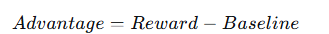

Reward 是“绝对成绩”，而 Advantage 是“相对表现”。

因此，绝对成绩不能为负，而advantag作为评判，有正负

因为 PyTorch 的优化器只会“最小化（Minimize）”，而我们需要“最大化（Maximize）”熵。
因为我们想让模型保持探索性，也就是最大化熵，但 PyTorch 优化器只认 Loss，并且永远在寻找最小值。所以我们要把上面这个“最大化”的问题，取负数

因为 KL 散度不是“距离”，它是“相对熵”。距离是对称的（A 到 B 等于 B 到 A），但相对熵有明确的方向性。交换 KL 的左右位置，相当于把“求稳”变成了“盲从”。一旦方向搞反，模型可能瞬间坍塌，忘记之前学到的一切。